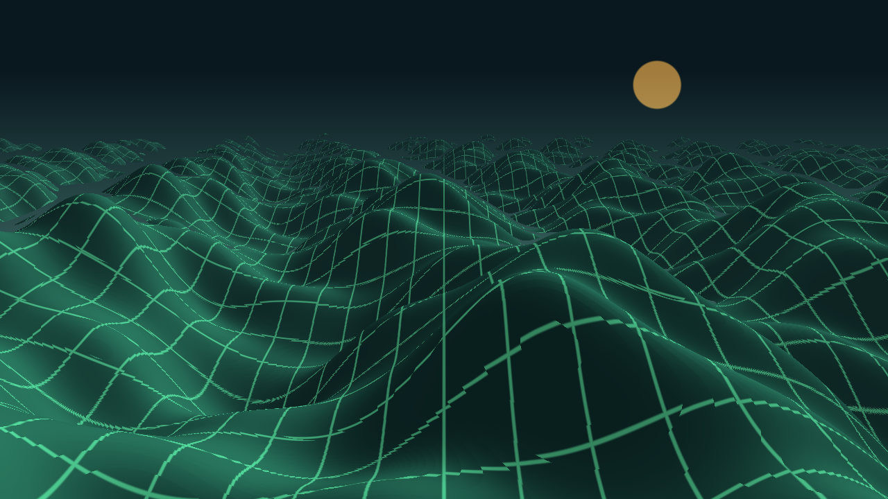

# World Finance Legacy Gaming

**Next-generation games. Older hardware. Open-source innovation.**

An independent graphics research lab initiated and sponsored by World Finance. We measure what older GPUs can actually render and publish the workload, raw timings and image-quality cost. Software, research data and participation are freely available. [Português](README.pt-BR.md) · [Website](https://luizendIA.github.io/worldfinance-legacy-gaming/) · [Discussions](https://github.com/luizendIA/worldfinance-legacy-gaming/discussions)

### First result

On a physical Radeon RX 570, our original terrain scene took **4.343 ms** at 1280 × 720 and **1.505 ms** at 640 × 360 with bilinear upscaling to the same output. These are medians of four run medians for two GPU passes. RGB RMSE was 7.613/255. D3D12 reported Shader Model 6.5 and Mesh Shader Tier 0. GTA VI remains untested. [Method, hardware matrix and raw samples](benchmarks/README.md) · [Feasibility report](reports/rx570.md)



### Build and run

Use Windows x64, Visual Studio 2022 Build Tools with Desktop development with C++, a Windows 10/11 SDK and CMake 3.20+. The first physical DXGI adapter is selected by default. Inspect the adapter name in the output on multi-GPU machines.

```powershell
cmake -S . -B build -G "Visual Studio 17 2022" -A x64
cmake --build build --config Release
ctest --test-dir build -C Release --output-on-failure
.\build\Release\legacy-lab.exe | Out-File -Encoding utf8 run-1.json
.\build\Release\legacy-lab.exe --reverse | Out-File -Encoding utf8 run-2.json
python tools/summarize.py run-1.json run-2.json
```

`--smoke` checks a small image without measuring timings. `--warp` explicitly selects Microsoft's software adapter. `--capture frame.ppm` also writes the native synthetic frame. Use a new output path. [Build and checksums](reports/build.md)

### Reference and licensing

Marvisak and the VIctory contributors authored the reference project. Its pinned tree includes a BCPack data table expressly excluded from the upstream license. This public lab has an independent Git history and an original renderer. The research credits and links to VIctory preserve the provenance trail. This project has no affiliation with Rockstar Games. Lab source and generated materials are offered under GPL-3.0-or-later. [Pinned upstream](https://github.com/Marvisak/VIctory/tree/ffe310eb2098e52169f4c44db5ffdabf43a72622) · [Redistribution and audit decision](reports/upstream-review.md) · [License](LICENSE)

### Participate

Start with the [contribution guide](CONTRIBUTING.md), [roadmap](ROADMAP.md), [release history](CHANGELOG.md), [security policy](SECURITY.md) or [outreach drafts](outreach/README.md).

**Powered by World Finance**

World Finance supports open-source innovation and research aimed at making modern gaming technology more accessible to people around the world, including those who cannot afford expensive gaming hardware.

Our mission is to explore new possibilities through engineering, community collaboration and technological innovation.

Explore World Finance and learn how to voluntarily support our research. Participation and downloads are free. [Support Open-Source Development](https://luizendIA.github.io/worldfinance-legacy-gaming/#support)

[Dynamic resolution on the RX 570: GPU time and image quality](benchmarks/dynamic-rx570/README.md)
