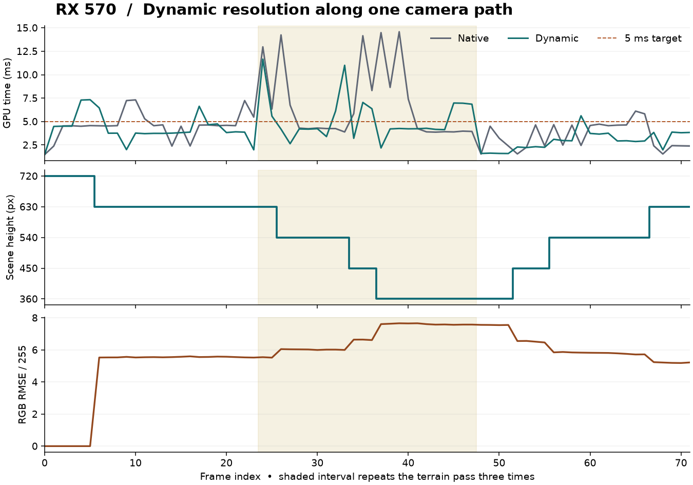

# Dynamic resolution on a physical RX 570

WordFinance · 24 November 2026 · 1280 × 720 output · Original, offscreen D3D11 terrain

With a **5 ms GPU budget**, dynamic resolution reduced the mean GPU render time from **4.987 to 4.042 ms** (18.95%) across four paired runs. The RGB root mean square error against native 720p was **5.286 on a 0–255 scale**. With an **8 ms budget**, the controller spent 261 of 288 frames at native resolution. The small difference in average GPU time at that setting changed sign across runs. GTA VI remains untested.

## Measured tradeoff

| Final series, four pairs per target | Native GPU mean | Dynamic GPU mean | Native / dynamic GPU p95 | Frames within budget, native / dynamic | Dynamic RGB RMSE / worst frame |
| --- | ---: | ---: | ---: | ---: | ---: |
| 5 ms | 4.987 ms | 4.042 ms | 12.410 / 7.358 ms | 208 / 238 of 288 | 5.286 / 7.661 |
| 8 ms | 5.455 ms | 5.426 ms | 12.073 / 12.044 ms | 257 / 259 of 288 | 1.675 / 5.543 |

Each mean includes all 288 measured frames for that mode. p95 is nearest rank per 72-frame run, followed by the median across the four runs. The 5 ms mode reduced mean GPU time in all four pairs, by 15.31–21.89%. For 8 ms, changes ranged from a 3.10% reduction to a 3.53% increase. GPU load, clocks and desktop scheduling can vary between paired sequences.

**Host-observed time** from camera update through GPU synchronization and controller decision averaged 15.751 → 15.258 ms at the 5 ms target and 15.993 → 16.299 ms at the 8 ms target. Query polling requests a 1 ms Windows sleep and can wake later. The lab has no swap chain or presentation step. GPU time measures the rendering work; neither timing establishes a displayed game frame rate.

## What the image difference looks like

| Native reference | Dynamic render, enlarged to 720p |
| --- | --- |
|  |  |

Both images are lossless captures of frame 36 in the first 5 ms run. The controller chose **800 × 450** for this frame, with RGB RMSE **6.614/255**. Compare the fine grid on the hills. The experiment measures differences in RGB code values; it does not assign a percentage to perceived image quality or assess temporal flicker.



## Method

- Radeon RX 570 Series 4 GB, driver 31.0.21924.61, Xeon E5-2666 v3, 16 GB RAM, Windows 10 Pro 19045. Each fresh process runs a native sequence and an adaptive sequence. Four processes alternate which runs first.
- Each sequence warms up with eight draws, then follows the same 72 camera positions. Frames 0–23 and 48–71 draw terrain once. Frames 24–47 draw it three times into the same target to introduce controlled overdraw. One bilinear pass composites to 1280 × 720 in all cases.
- Five preallocated scene sizes span 50%, 62.5%, 75%, 87.5% and 100% of each output dimension. Start at 100%. After two consecutive GPU times above budget, step down once. After four consecutive frames whose predicted time at the next scale is below 90% of budget, step up. Prediction scales the last measured GPU time by the pixel-count ratio. A change applies to the next frame and clears both counters. This controller optimizes GPU work; preallocation incurs extra memory.
- GPU timestamps bracket terrain and composite draws. Every interval is checked for clock disjointness and validity. The host waits for each result. Allocation, shader compilation, warm-ups and image readback are outside GPU timing.
- After both timed sequences, replay the recorded sizes at the same camera positions and compare the full 1280 × 720 RGB output against a fresh native render for every frame. Aggregate RMSE weights every frame and RGB channel equally. All full-resolution comparisons had zero error. Frame 36 was selected in advance as the midpoint of the higher-load interval.
- The first four exploratory pairs used a hard-coded 8 ms target. Three adaptive sequences stayed native throughout. That pilot averaged 5.278 ms native and 5.426 ms dynamic. We retained those traces, exposed the target as an option, then ran four pairs at 5 ms followed by four at 8 ms on the final build. The table above uses only these final-build series. Four repeats on one physical GPU establish a local result.

[5 ms raw captures](raw/5ms) · [8 ms raw captures](raw/8ms) · [Initial 8 ms pilot](raw/pilot-8ms)

## Run locally

Build using the [Windows instructions](../../README.md). Run from the repository root. The benchmark prints one JSON document. The optional image directory must be new and receives both PPM images for frame 36.

```powershell
.\build\Release\legacy-lab.exe --dynamic --budget-ms 5 --images capture-images | Out-File -Encoding utf8 pair-1.json
.\build\Release\legacy-lab.exe --dynamic --budget-ms 5 --reverse | Out-File -Encoding utf8 pair-2.json
python tools/dynamic_summary.py benchmarks/dynamic-rx570/raw/5ms
python tools/dynamic_summary.py benchmarks/dynamic-rx570/raw/8ms
```

Use a fresh output file for each repetition. Two local Release builds using MSVC 19.44.35229 and Windows SDK 10.0.26100.0 produced the same SHA-256, `1c85c94701ebbe29f46e4327a1dc352ae00e4233236c0f15708621764ab33974`. The pilot executable SHA-256 was `2c4b810642b3f2bf9ed4a3f19be6f248051e701dd0f9bd6e38126256ee384908`.
