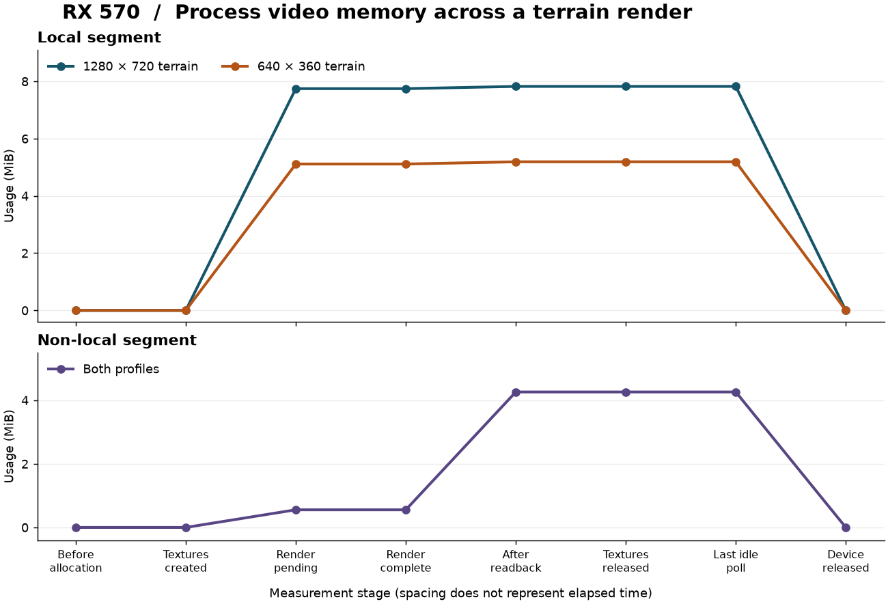

# How much VRAM does the terrain renderer use?

WordFinance · 24 November 2026 · Physical Radeon RX 570 4 GB

At a fixed 1280 × 720 output, reducing the terrain pass from 1280 × 720 to 640 × 360 reduced **observed local process usage during rendering by 2.633 MiB**. Each profile reproduced its byte counts in four fresh processes. This is a measurement of a small synthetic D3D11 scene on Windows 10 Pro 19045, driver 31.0.21924.61, Xeon E5-2666 v3 and 16 GB RAM.



| Measurement stage | Native local (MiB) | Scaled local (MiB) | Non-local, either profile (MiB) |
| --- | ---: | ---: | ---: |
| Renderer ready, before scene allocation | 0.000 | 0.000 | 0.000 |
| Both color textures and views created | 0.000 | 0.000 | 0.000 |
| Render commands outstanding at preceding event poll | 7.746 | 5.113 | 0.555 |
| GPU completion event signaled, before staging | 7.746 | 5.113 | 0.555 |
| After GPU-to-CPU readback, staging texture alive | 7.824 | 5.191 | 4.262 |
| Texture references released and context flushed | 7.824 | 5.191 | 4.262 |
| Last cleanup poll, device still alive | 7.824 | 5.191 | 4.262 |
| Immediately after releasing the D3D11 device and context | 0.000 | 0.000 | 0.000 |

One MiB is 1,048,576 bytes. Every sample in a given phase for a given profile returned the same usage. The raw JSON gives integer bytes and elapsed microseconds for each observation. Across these captures the reported local budget was 3,631,994,676 bytes and the non-local budget was 7,814,001,357 bytes. A budget is a limit assigned to the process and can change with system pressure. [Eight raw captures](raw) · [DXGI QueryVideoMemoryInfo](https://learn.microsoft.com/en-us/windows/win32/api/dxgi1_4/nf-dxgi1_4-idxgiadapter3-queryvideomemoryinfo)

## What changed with resolution?

The RGBA8 scene texture contains 3,686,400 bytes at full scale and 921,600 bytes at reduced scale. Both profiles keep a separate full-size 3,686,400-byte output. The calculated payload reduction is 2,764,800 bytes. The measured difference during rendering was **2,760,704 bytes** (8,122,368 minus 5,361,664), 4,096 bytes below the payload difference. The counters cover the entire process on the selected adapter. Resource layout, allocator granularity and driver bookkeeping were not measured individually.

Readback increased observed non-local usage from 581,632 to 4,468,736 bytes in both profiles. With the device alive, counters retained their post-readback values throughout the cleanup polling window, which ended 312–333 ms after the first release sample. Device destruction returned both counters to zero. These observations do not distinguish allocator reuse from deferred accounting. A zero counter before drawing also does not establish that the driver allocated no storage.

## Measurement protocol

- Start a fresh process per profile. Four pairs ran in native/scaled, scaled/native, native/scaled, scaled/native order. Both profiles render 32 terrain frames. GPU timing is outside the scope of this instrumentation.
- Query node 0 of the selected physical adapter using IDXGIAdapter3. Record CurrentUsage and Budget for both LOCAL and NON_LOCAL at each stage. The two segment queries are consecutive. Timestamps use a monotonic process clock at the start of each pair.
- Capture the baseline after device, shader and sampler creation. Keep the full-size output fixed. Bound requested image storage to the scene texture, output and one full-size staging texture. Before allocations and while polling, check the current local headroom, keeping a 64 MiB margin.
- Submit an event after the final draw and flush. While the event reports pending, sample both segments and request a 5 ms sleep between polls. Abort after 15 seconds. Sample once after completion. An event can signal between polling and querying memory. The samples establish observed usage over the submitted workload; short-lived peaks could fall between samples.
- Copy to staging, map, copy rows and unmap before the readback sample. Release all three texture references, flush, sample immediately, then sample ten more times with a requested 25 ms sleep. Windows scheduling changes the actual intervals. Check readback contrast, destroy the renderer and sample once more using the retained DXGI adapter.
- These are per-process DXGI segment counters. Whole-board usage by other processes, peak between samples, CPU heap usage, and behavior of commercial games were outside this experiment.

## Reproduce or inspect offline

Build the x64 Release executable using the [build instructions](../../README.md). Each command starts a new process. For the four-pair repeat, alternate the order above and use a fresh filename each time.

```powershell
.\build\Release\legacy-lab.exe --vram native | Out-File -Encoding utf8 native-1.json
.\build\Release\legacy-lab.exe --vram scaled | Out-File -Encoding utf8 scaled-1.json
python tools/vram_summary.py native-1.json scaled-1.json
python tools/vram_summary.py benchmarks/vram-rx570/raw
```

Two local x64 Release builds produced executable SHA-256 `373622a13625205c340b16162fb77727118f57fac0deb49e85985d0081a3d782` with MSVC 19.44.35229 and SDK 10.0.26100.0. The on-disk JSON contains the adapter model and measurement data. Repetition on a second physical board remains open.
