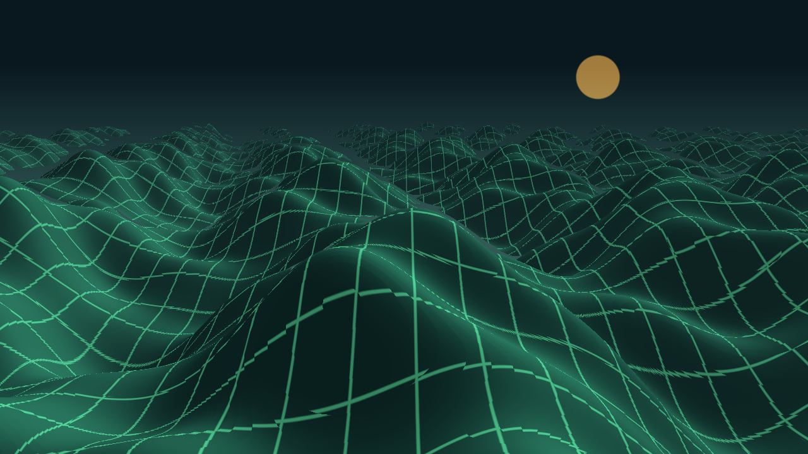

# Vulkan vs Direct3D 11 at native 720p on Polaris

WordFinance · 24 November 2026 · Physical Radeon RX 570 4 GB

We rendered the original terrain from the dynamic-resolution experiment through two native graphics backends. Both used the same HLSL source, camera positions, 1280 × 720 RGBA8 scene texture, bilinear composite and output size. With both processes polling GPU completion on the same requested interval, the Vulkan build averaged **4.414 ms** on the GPU and D3D11 averaged **5.278 ms**, a **16.4% reduction** across four pairs. Results varied substantially between runs. GTA VI was not run.

| Both backends polling | D3D11 | Vulkan |
| --- | ---: | ---: |
| Pair 1, mean GPU ms | 5.548 | 5.405 |
| Pair 2, mean GPU ms | 3.996 | 1.801 |
| Pair 3, mean GPU ms | 5.475 | 5.069 |
| Pair 4, mean GPU ms | 6.093 | 5.379 |
| GPU p95, median of run percentiles (ms) | 12.202 | 11.945 |
| Mean synchronized host time (ms) | 15.845 | 15.627 |

An additional local launcher verification after the four planned pairs yielded 5.865 ms in D3D11 and 5.881 ms in Vulkan, effectively tied. Its independent trace is available [here](launcher-check/run-1.json) and is outside the table above.

The paired reductions ranged from **2.6% to 54.9%**. Pair 2 accounts for most of the aggregate difference. Host time includes submitting commands, synchronizing and collecting timestamps. There is no presentation step and this test yields no displayed-game FPS. [Raw matched-poll records](raw/matched-poll)

## Image fidelity

| D3D11, frame 36 | Vulkan, frame 36 |
| --- | --- |
|  |  |

RGB RMSE was **0.0461** in 8-bit code values over all 288 frame pairs in each series. **0.0002803%** of pixels differed by more than one code value in any RGB channel. The largest single-channel difference was **102/255**. The images are very close overall, with occasional locally larger errors. Every frame was checked for full alpha, sufficient scene contrast and matching dimensions. Each JSON records the squared error, largest difference, count over threshold and SHA-256 of both uncompressed RGBA frames.

## Why we repeated the comparison

The first series used D3D11's existing timestamp poll with Sleep(1) and Vulkan's blocking fence wait. It yielded 5.574 vs 1.887 ms mean GPU time and 15.759 vs 2.238 ms mean synchronized host time. We then added a Vulkan mode that polls completion with Sleep(1) and repeated both APIs in new processes. Different waiting policies change the submission cadence; dynamic clocks, driver scheduling and compiler differences can affect timings. We did not record clock speeds or establish a unique cause. The two series are published separately. [First-series data](raw/native-waits)

## Hardware and method

- Radeon RX 570 Series 4 GB, Xeon E5-2666 v3, 16 GB RAM, Windows 10 Pro 19045, Windows driver 31.0.21924.61. The AMD Vulkan driver reported Vulkan 1.3.260, vendor 0x1002, device 0x67df, subgroup size 64 and timestamp period 40 ns. Dynamic rendering was enabled. Neither VK_EXT_mesh_shader nor VK_NV_mesh_shader appeared in the device extension list. The earlier D3D12 probe on this stack found Shader Model 6.5 and Mesh Shader Tier 0.
- Each series: four pairs, alternating D3D11-first and Vulkan-first. Each fresh process executes eight warm-ups, then 72 timed frames, then replays the camera path to read back all 72 frames outside timing. All 72 positions remain native 720p. Frames 24–47 draw the terrain three times, all others once; each frame has one composite pass.
- D3D11 compiles the HLSL with D3DCompile to shader model 5 bytecode. Vulkan uses glslang 14.3.0 to compile the same entry points to SPIR-V, with a vertex Y adjustment and the camera value supplied via a push constant. Each uses its own driver's pipeline compiler. The test compares these specific implementations.
- D3D11 uses timestamp/disjoint queries around the draws. Vulkan uses top/bottom-of-pipe timestamps around layout transitions, rendering and compositing. A fence separates submissions. Shader compilation, startup, image readback and file writes are outside the timed sequence. The nominal 1 ms polling sleep is subject to Windows scheduling. Thermals, background load and GPU clocks were uncontrolled.
- Each overall GPU mean includes all 288 frames per backend and series. p95 is nearest rank within each run, followed by the median across four runs. RGB error is calculated across the full replay, weighting channels, pixels and frames equally.

## Reproduce on Windows

Use an x64 MSVC toolchain, a Windows SDK, CMake, Vulkan headers and loader import library, and a glslang compiler with HLSL support. A Vulkan SDK with these components is sufficient. The default build remains D3D11-only. The optional renderer requires a physical Vulkan 1.3 graphics queue with timestamp support, dynamic rendering and coherent host readback memory. The comparator uses Python and NumPy; inspecting saved JSON summaries only needs Python.

```powershell
cmake -S . -B build-api -G "Visual Studio 17 2022" -A x64 -DLEGACY_VULKAN=ON
cmake --build build-api --config Release
.\build-api\Release\legacy-lab.exe --api-reference d3d-run1 | Out-File -Encoding utf8 d3d-times.json
.\build-api\vulkan\Release\legacy-vulkan.exe vk-run1 --match-poll | Out-File -Encoding utf8 vk-times.json
Copy-Item d3d-times.json d3d-run1/times.json
Copy-Item vk-times.json vk-run1/times.json
python tools/compare_apis.py --pair d3d-run1 vk-run1 > pair.json
python tools/compare_apis.py --summary benchmarks/vulkan-rx570/raw/matched-poll
```

Use new capture directories per process. Verify both names identify the intended physical adapter on multi-GPU systems. One pair of full raw replays needs about 506 MiB of scratch space. Omit `--match-poll` to use Vulkan's blocking fence wait. The comparison tool reads data locally.

The reference build used MSVC 19.44.35229, Windows SDK 10.0.26100.0, Khronos Vulkan-Headers v1.3.280 at `577baa05033cf1d9236b3d078ca4b3269ed87a2b`, an import library generated from the installed system loader exports and the locally installed glslangValidator. Local Release SHA-256 values:

| Executable | SHA-256 |
| --- | --- |
| D3D11 reference, both series | `73d1b27b0e376b4cdc63c3aa61c4e5f244a2e13fafc2c7537f6a7285d9d90195` |
| Vulkan, first series | `92524230a88152f8d9f62d6a34fa9cd941fa75a55611a8245329e19a4f8fca15` |
| Vulkan, matched-poll build | `c8f38c2a5b36335a80d3f81ff7fd421e99a7e265e0fd14f26dbc0c44561b73ed` |

## Relevance to GTA VI

This establishes a working Vulkan path for a conventional vertex/pixel workload on Polaris. A title-specific path would also have to implement required geometry and shader semantics, memory behavior and platform services. Dropping resolution cannot add the missing mesh-shader capability. Rockstar lists PS5 and Xbox Series X|S. The inspected VIctory revision still describes its implementation as unplayable and reports testing on an RX 6700 XT. No commercial game executable or asset was used for this comparison. [Rockstar platform information](https://support.rockstargames.com/articles/4QfG4FmZCf5W1gS8jy4UVT/grand-theft-auto-vi-platform-editions-and-versions) · [VIctory at the reviewed revision](https://github.com/Marvisak/VIctory/blob/940d32f69b22265690a0b5a15d6ded572ba33baf/README.md)
